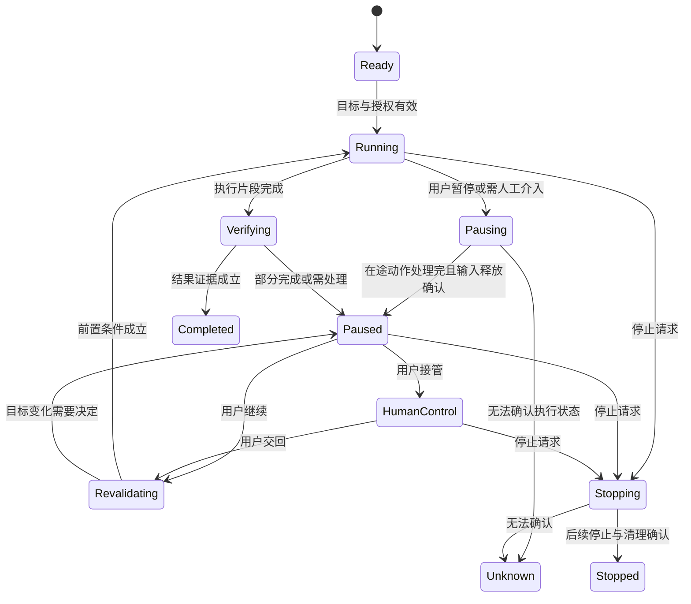
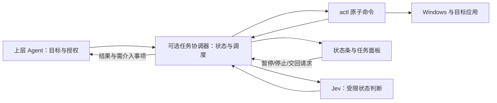

# 11 · 桌面自动化的显示层与人机协作体验

调研日期：2026-09-26 · 状态：后期产品研究与交互提案，未实现、未做用户实测 · 2026-09-27 增补 §14（渲染栈选型分析）

关联：[现行 PRD](PRD.md) · [现行命令协议](06-design-blueprint.md) · [Agent/Jev 分工](08-agent-cli-jev-design-proposal.md) · [输入占用边界](09-input-backends-review.md) · [Quicker 需求研究](10-quicker-demand-research.md) · [实时状态维护](13-realtime-state-maintenance.md)

> 本文回答：用户如何观察桌面任务、何时可以继续使用电脑、怎样暂停和介入，以及如何放心地让任务继续。本文不修改现行命令或授权语义。独立显示程序、会话协调器、控制通道、任务记录和执行隔离均属于后期提案；其中涉及 PRD §1.3 的常驻程序、热键或范围扩展，须先另行评审。这里研究的任务显示层不承担可视化编排、动作市场或第二套聊天入口。

## 1. 推荐方向

推荐采用“上层对话入口 + 按需出现的任务状态条 + 可展开详情 + 明确的人工交接”四部分。终端分屏是可选观察布局，不是运行前提；真正边工作边运行的能力必须由执行隔离和资源协调提供，不能由 UI 布局承诺。

显示层首先回答四个问题：

1. 正在处理哪个应用、哪个文档，做什么？
2. 此刻是否占用我的鼠标、键盘焦点或剪贴板？
3. 我需要看着、等待，还是做一个具体操作？
4. 我按暂停以后究竟停了什么，已经发生的修改还在不在？

优先级应是：控制真实有效 → 目标与状态可理解 → 人工交接顺畅 → 界面紧凑美观。一个有停止按钮但无法停止执行的悬浮条，比没有悬浮条更容易造成错误预期。

## 2. 调研方法与证据边界

本轮阅读了项目 PRD、协议蓝图、现有 CLI 入口和 envelope 实现，并查阅 Microsoft Power Automate、UiPath Assistant、Claude Cowork 的官方资料，结合 Windows 通知/窗口机制、W3C 无障碍指导和人机交互研究。没有安装这些产品、运行真实接管实验或访问用户使用数据。

因此本文区分三类内容：官方文档描述的产品行为、由其推导的本项目设计建议、需要原型验证的假设。尺寸、时间阈值和验收目标均为候选设计，不是测量结果。官方页面会更新，落地前需复查版本和平台差异。

### 2.1 可借鉴的机制

| 来源 | 官方资料提供的事实 | 对 actl 的启发与边界 |
|---|---|---|
| Power Automate PiP | 区分 child session 与预览中的 virtual desktop；后者目前不支持物理输入和截图，child session 还存在剪贴板共享等限制。[来源](https://learn.microsoft.com/en-us/power-automate/desktop-flows/run-desktop-flows-pip) | “隔离运行”必须列出隔离了什么；不能用一个画中画图标概括全部能力 |
| UiPath Robot session | 分开观察与 Join 操作，支持不同会话/桌面技术。[来源](https://docs.uipath.com/assistant/standalone/latest/user-guide/picture-in-picture) | 看画面不应自动变成输入接管；加入操作应有明确入口 |
| Claude Cowork computer use | 官方说明可以停止执行，并指出跨应用操作可能影响其他应用。[来源](https://support.claude.com/en/articles/14128542-let-claude-use-your-computer-in-cowork) | 控制权需要随手可达；目标应用授权和实际副作用不能只靠窗口外框表达 |
| Windows 通知指南 | 避免过度通知；用户点击通知后应进入对应任务上下文。[来源](https://learn.microsoft.com/en-us/windows/apps/design/shell/tiles-and-notifications/toast-ux-guidance) | 只在需要决定、介入或查看结果时打断，普通步骤在任务内更新 |
| Windows 扩展窗口样式 | `WS_EX_NOACTIVATE` 可避免窗口点击时成为前台，但文档也限制其通过辅助技术激活；`WS_EX_TRANSPARENT` 的描述是绘制顺序，并非通用点击穿透保证。[来源](https://learn.microsoft.com/en-us/windows/win32/winmsg/extended-window-styles) | 不抢焦点的提示条与可键盘操作的控制面板需要分别设计、实测 |
| W3C 状态消息与焦点可见性 | 状态变化应能被辅助技术获知而无需抢焦点，持久覆盖层也需考虑焦点控件是否被遮挡。[状态消息](https://www.w3.org/WAI/WCAG21/Understanding/status-messages) · [焦点可见](https://www.w3.org/WAI/WCAG22/Understanding/focus-not-obscured-minimum) | 状态不能只靠颜色；停止和介入入口不能藏在 hover 中。这是设计借鉴，不等于已达到 WCAG 合规 |
| CHI 2019 人机交互指南 | 研究整理了能力说明、纠错和用户控制等 AI 交互原则，并进行了多轮评估。[论文](https://www.microsoft.com/en-us/research/publication/guidelines-for-human-ai-interaction/) | 提前说明边界，失败时提供可执行的下一步；本项目仍需自己的用户测试 |

### 2.2 本项目的真实起点

当前实现以一次 CLI 调用返回一个 JSON envelope 为中心，尚未建立本文需要的跨调用任务状态、输入租约、暂停确认、人工交接和显示会话协议。不能仅从命令开始/结束推断中间阶段，更不能让 UI 用定时器假装后端进度。

现行 PRD 的“UIA 后台调用”描述，落地时还需结合输入评审理解：没有鼠标注入不代表应用不会打开对话框、改变焦点或修改数据。显示文案不能将 UIA 统一翻译为“完全不影响你”。

## 3. 用户不是一直在监督同一种任务

| 使用情境 | 用户真正关心的事 | 推荐呈现 |
|---|---|---|
| 初次试用，怕点错 | 对象是否正确、能否停下 | 目标摘要、显眼的暂停入口，可选分屏 |
| 熟悉的短任务 | 有没有完成、结果在哪里 | 低干扰状态，完成结果卡 |
| 需要物理输入的任务 | 何时轮到自己用电脑 | 占用提示、暂停并接管、剩余阶段信息 |
| 等模型/网络/应用处理 | 为什么不动、是否卡住 | 真实等待原因、已等待时长，释放输入 |
| 登录或真人验证 | 我在哪操作、完成后怎么办 | 人工介入卡、目标定位、明确恢复按钮 |
| 开发调试 | 哪个目标/命令错了 | 可展开的步骤、证据和错误信息 |
| 多个 agent 同时运行 | 谁占用桌面、任务是否互相干扰 | 单一桌面占用提示、排队任务及 owner |

“用户需要可监督”不等于“用户必须一直看”。日常体验应尽量减少必须盯屏的时间；需要用户持续监督的阶段则明确表达，不伪装为可以离开的后台任务。

## 4. 分屏、双屏、悬浮条和隔离桌面的选择

| 形态 | 适用场景 | 优势 | 主要代价/误区 | 建议 |
|---|---|---|---|---|---|
| 终端与应用分屏 | 初学、调试、短任务监督 | 同时看到原因与效果 | 挤压应用，改变布局；仍共享输入焦点 | 用户主动开启，可选预设布局 |
| 双屏 | 已有多显示器的用户 | 保留完整应用空间 | 鼠标与键盘仍共享，不等于并行操作 | 记住显示偏好，不要求购买设备 |
| 小型悬浮状态条 | 日常观察、短暂物理占用 | 视线移动少、随时可见 | 可能遮挡目标、被自动化误识别、抢焦点 | 推荐的日常显示层，需要遮挡与无障碍验证 |
| 可展开任务面板 | 介入、检查结果、排错 | 信息完整，支持键盘导航 | 展开会与当前操作争夺焦点 | 用户主动展开；需要输入时先暂停相关执行 |
| 托盘/系统通知 | 后台等待、完成提醒 | 占用空间少 | 可被隐藏或勿扰抑制，不能承担唯一停止入口 | 辅助渠道 |
| 独立桌面/会话/VM 预览 | 长时间 GUI 自动化并行办公 | 有机会隔离输入环境 | 登录、应用实例、文件与剪贴板仍有边界 | 单独立项，逐应用验证，不绑定显示层首版 |

### 4.1 分屏应如何做

用户主动选择“并排观察”时，才提出终端/面板约 1/3、目标应用约 2/3 的初始布局；比例只是起点，应按应用最小宽度和系统缩放调整。操作中的自动分屏会改变控件位置、文本换行、工具栏折叠，可能使定位失效，因此布局变更要在暂停并释放输入后进行，再重新观察。

不要每一步都把终端切到前台。用户切回终端可能只是想读进度，也可能是要打断任务；共享物理执行时应让出控制，不能自动夺回焦点。结束后是否恢复窗口布局应由用户选择；仅在窗口仍是原实例且用户没有重新布置时才可提供恢复，不覆盖用户的新布局。

### 4.2 隔离的说法必须准确

普通 Windows 多桌面、分屏或把窗口放到第二块屏幕，本项目都不能据此承诺独立输入。RPA 的“virtual desktop”是其运行时提供的模式，也不能与用户按 Win+Tab 创建的桌面直接等同。输入、进程、文件、剪贴板、登录状态和应用单实例约束要分别验证。

如果后期提供隔离环境，应显示“任务运行于独立环境”，并明确结果保存位置和文件传递方式。原来用户已经打开的未保存文档不会自动变成隔离环境中的同一份对象；迁移环境应重新绑定任务。当前桌面遇到冲突时不能静默搬到另一个环境继续。

## 5. 显示层的信息架构

### 5.1 四层信息，逐步展开

1. 上层对话：下达目标、修改范围、解释复杂失败。复用用户正在使用的 Codex/Claude Code 等入口。
2. 状态条：显示当前任务、目标、阶段、输入影响和控制入口。无需阅读日志。
3. 任务面板：显示目标摘要、已完成修改、等待原因、介入步骤、结果与可恢复位置。
4. 诊断详情：命令、目标身份、错误码、时间戳、证据引用。默认折叠，支持复制脱敏诊断。

同一个任务只有一个权威执行状态。聊天中“我已暂停”的自然语言不能更新状态条；只有执行协调器确认后才能显示暂停成功。

### 5.2 状态条草图

```text
┌──────────────────────────────────────────────────────────┐
│ 保存报告 · 记事本「月度总结」                             │
│ 正在填写文件名 · 正在使用键盘焦点                         │
│ [暂停并接管]   [详情]                         [停止任务]  │
└──────────────────────────────────────────────────────────┘
```

不在正常模式显示 ref、PID 或 Jev confidence。目标摘要应能区分同名窗口，可显示文档名和路径末段；路径不可得时说明“文档路径未确认”，在歧义消除前不写入。技术身份留在详情中。

显示条建议以 360–480 DIP 宽度起步做原型，不当作固定规格；中文放大、长标题和多任务状态需要换行。停用持续闪烁和装饰性动画；输入占用不能只用红/绿灯表达。

### 5.3 位置与遮挡

默认靠近目标所在显示器的空闲边缘，使用系统工作区边界，避开任务栏和当前目标控件。状态条位置在一个操作片段内尽量稳定，不追着鼠标跑。用户拖动时先让物理执行暂停；原位置遮挡即将操作的控件时，在片段边界重排并重新验证目标。

如果无法找到不遮挡的位置，收起为紧凑标记，并提供始终可达的其他停止路径；不能为了美观移除最后一个有效控制入口。提示条和面板自身应从 actl 的一般目标候选中排除，以免 agent 操作自己的控制界面；它们仍需对系统辅助技术可见。

主动打开详情属于用户行为，可以获得焦点；后台状态更新则不能主动激活窗口。非激活提示条不能成为唯一键盘交互入口，应有正常可激活、支持 Narrator 的面板。

## 6. 用“任务状态 + 资源占用 + 是否需介入”表达现场

三者是独立维度。例如任务正在等应用响应时，仍可能存在尚未结束的调用；等待模型时则不应保留输入占用。不要将一个 running 布尔值映射成整条体验。

| 场景 | 面向用户的文案示例 | 可以承诺什么 |
|---|---|---|
| 读取窗口信息 | 正在读取报告窗口 · 未使用鼠标键盘 | 仅描述这次动作，不承诺后续无副作用 |
| UIA 写字段 | 正在修改指定字段 · 未注入鼠标键盘 | 用户不要同时编辑同一对象；应用仍可能变更焦点 |
| 键盘注入 | 正在使用键盘焦点 · 可暂停并接管 | 虽未移动鼠标，切换窗口仍会干扰 |
| 鼠标注入 | 正在操作鼠标 · 可暂停并接管 | 有明确物理授权和执行占用 |
| 等模型结果 | 正在判断下一步 · 输入已释放 | 用户可使用其他应用，目标变化后需重验证 |
| 排队 | 等待桌面使用权 · 前方 1 个任务 | 不占用输入，不暗示已执行 |
| 人工处理 | 等你完成验证 · 自动操作已暂停 | 控制器确认已停后才显示后半句 |
| 状态失联 | 执行状态未知 · 最后更新于 12:04:08 | 不显示成功或“可放心操作” |

剪贴板影响单独注明，例如“此步骤会暂时使用剪贴板”。使用结束后不能无条件恢复旧值，避免覆盖用户后来复制的内容；只在内容仍属于本任务且恢复方式已验证时恢复。

### 6.1 进度可信度

固定字段填充可以显示“已验证 3/8 个字段”。开放任务只显示实际阶段和已完成结果，例如“已打开导出框，等待文件生成”；不显示凭模型猜测的 73%。阶段数随计划改变时用文字解释变化，不让进度突然倒退而无说明。

等待时显示原因、耗时和真实配置的超时。反复出现同一状态只更新时间，不持续追加通知。事件长时间未更新时区分“正在执行已知长调用”和“连接中断”；模型的解释不能覆盖底层失联事实。

## 7. 暂停、接管、停止、恢复的精确定义

| 控件 | 意图 | 执行语义 | 不代表什么 |
|---|---|---|---|
| 暂停 | 暂时不继续自动操作 | 停止调度新动作，处理在途动作，确认输入清理后保留任务 | 不撤销已经保存或提交的结果 |
| 暂停并接管 | 用户现在要自己操作 | 暂停确认后将任务控制权标记为用户，并展示恢复入口 | 不依靠“鼠标不动了”推断成功 |
| 停止任务 | 不再继续这项任务 | 取消后续计划，清理本任务持有输入，输出部分结果 | 不等于关闭目标应用或回滚数据 |
| 继续任务 | 用户交回控制权 | 重新观察目标、检查前置条件与已有结果，然后执行剩余部分 | 不从旧坐标、旧 ref 或未知副作用处盲目重放 |

### 7.1 状态机



图中省略排队、预算耗尽等分支；这是交互模型，不是现行协议枚举。

按下按钮后立即显示“正在暂停”，收到确认才显示“已暂停”。阻塞的 UIA 调用或已经提交给应用的动作未必能立即撤销；超时应解释“已禁止新步骤，当前调用状态尚未确认”。不能靠杀进程保证键鼠清理，也不能把“取消请求已收到”当成“已停止”。

暂停渠道需要独立于模型推理和长调用。后期可评估可配置的本地紧急停止组合键，但这是范围扩展，并非复用目标应用的 Esc：Esc 可能关闭对话框或改变原任务，不能默认当作全局停止。快捷键应在使用前验证注册成功，冲突时显示可用替代途径。

### 7.2 控制面板自身引发的竞争

用户移动鼠标去点暂停，可能与自动化移动相撞；不能把一个移动目标旁的鼠标按钮当作唯一救援方式。需要经验证的键盘停止途径或其他独立控制路径。触摸、语音输入和辅助设备也要纳入介入测试。

检测到用户输入时让出控制是辅助机制，需要区分本工具注入与其他输入，不能宣称能识别所有意图。拖动中退出只能尽力释放本任务持有的按键/按钮，并报告拖动可能部分生效。共享会话无法提供与真实用户绝对互斥的事务。

### 7.3 人工恢复必须处理状态变化

用户可能不仅完成验证，还换了文档、改了字段或手动保存。恢复时对照“已完成事项、最后观察、目标实例、预期下一步”，保留用户的新修改；不因为表面窗口名称相同就继续。若用户已完成原目标，验证后直接结束。若存在提交结果未知，先查询证据，不能自动再次提交。

## 8. 六条完整用户旅程

### 8.1 首次：给已有记事本内容另存副本

1. 用户在上层 agent 下达保存目标和路径。绑定目标窗口实例；有多个候选时给出可区分摘要，让用户选择，不猜当前前台。
2. 任务卡显示“从哪份文档保存到哪里”，并说明是否预计需要输入焦点；已授权的常规操作不逐步弹确认。
3. 用户可选“并排观察”。布局完成后重新定位，任务进入执行。
4. 需要物理兜底且尚未授权时暂停，请上层取得明确授权；显示层按钮不得暗中启用 `--physical`。
5. 完成时显示目标路径和实际验证方式；只看到保存框消失不能直接宣称文件正确。
6. 用户点击“打开结果”才切换应用。完成提示不会抢走用户刚恢复的焦点。

### 8.2 熟悉任务：用户希望继续写邮件

任务先做文本处理或已确认不占用输入的步骤，状态条保持低干扰；不要仅因 UIA 模式就承诺可以编辑同一份文档。如果下一段要使用当前桌面键鼠，先进入“等待你交出输入”，用户选择“现在执行”或“稍后”。等待期间继续释放输入。

如果用户刚刚明确发起立即执行并已经授权本次物理操作，不再每个按键都询问；但用户介入或任务长时间等待后，不得静默重新抢走输入。用户主动继续后仍需检查目标，明确接下来将占用输入。倒计时不能替代授权或用户交回。

### 8.3 登录、真人验证等人工阶段

```text
需要你完成一个步骤
目标：浏览器 · 业务系统登录页
原因：页面要求真人验证
已完成：打开业务入口；尚未提交表单
状态：自动操作已暂停，输入已释放
[显示目标窗口]  [我已完成，继续]  [停止任务]
```

显示目标窗口由用户主动触发；点击后聚焦前重新确认实例。敏感输入阶段默认停止内容采集和截图，只有用户交回后才重新观察必要状态。不能仅停止截图却继续读取 UIA 文本，也不能在未知是否已停采集时显示“不会读取”。无法保证的上层记录应明确区分。

“我已完成”只触发重新验证，不直接标记成功。页面仍要求验证时保留人工状态，解释观察结果。长时间无回应可按已告知的等待策略挂起或结束，不能自行通过、重试提交或突然恢复。

### 8.4 用户发现目标不对并接管

暂停按钮先确认执行停止，展示已经修改的字段及尚未验证的部分。用户切换到正确文档后选择重新绑定；绑定范围变化由上层处理。恢复从新观察规划剩余任务，不复用旧引用。不要提供没有实现依据的一键“撤销全部”；只显示已验证可逆的单项补救，并说明影响。

### 8.5 用户离开、锁屏或应用崩溃

共享桌面的物理任务停止派发新动作，记录最后确认的步骤和未知结果。解锁、应用重启或窗口重建之后，进入待恢复状态，不自动继续。新窗口即使标题相同也应重新确认身份。失败卡要告诉用户“哪些已完成、哪些未确认、下一步是什么”，而不仅是错误码。

### 8.6 两个 agent 同时请求桌面

任务 A 占用键盘，任务 B 显示“等待 A 释放桌面”，而不是创建第二个相互遮挡的状态条。可以并行做不冲突的计算/网络工作；读取也可能观察到另一任务的中间状态，不能一概宣称安全。涉及同一文档的 UIA 写入仍需按资源协调。

用户接管桌面期间，A 和 B 都不能抢回物理输入。恢复某一任务不自动恢复所有排队任务；输入授权也不跨 agent 转移。队列要展示 owner、等待原因和取消入口，避免某个任务长期占用而其他任务只显示无限转圈。

## 9. 通知、关闭和隐私的交互细节

| 事件 | 状态条/面板 | 系统通知 | 焦点行为 |
|---|---|---|---|
| 普通步骤推进 | 原位置更新 | 不通知 | 不切换 |
| 开始需要物理输入 | 明确占用或等待交回 | 用户不在任务界面时可通知一次 | 不强行抢输入 |
| 需要人工介入 | 持久保留原因与按钮 | 一次可操作通知，去重 | 用户点击后才显示目标 |
| 可恢复失败 | 保留已完成与未确认项 | 按是否阻塞任务决定 | 不强行激活 |
| 任务完成 | 结果卡 | 用户已在看时通常不再通知 | 点击结果才跳转 |
| 连接中断 | 状态未知和最后更新时间 | 必要时提醒一次 | 不假装已停止 |

通知可能被系统抑制或用户错过，不能作为唯一控制渠道。通知中不默认展示完整文件路径、账号、字段内容或截图；锁屏可见信息采用最小摘要。旧通知的按钮要校验任务状态，完成任务的旧“继续”按钮不能重新启动操作。

收起、关闭详情、停止任务是不同动作。详情窗口的关闭只收起详情；任务继续时仍保留状态入口。用户退出整个显示程序时，如果它是当前物理任务唯一可用控制通道，应先暂停并确认，再退出；如果交接给另一个经确认可用的控制宿主，则明确提示任务仍继续。程序崩溃按后端失联策略处理，不能依赖退出对话框。

任务历史默认保存必要的结果和状态，不长期保存整屏视频、剪贴板或控件完整内容。证据采集、模型发送和本地显示是三个不同范围：用户愿意看到屏幕不等于同意持续截图存储或上传。保留期限和清除入口需在历史功能上线时明确。

## 10. 从 CLI 到显示层的架构边界



显示程序不解析模型自由文本来决定执行。Jev 可辅助判断应用阶段，不能决定用户已经让出控制权，不能修改授权或确认输入已释放；这些来自用户事件与执行事实。

### 10.1 兼容任意上层 agent 的能力分级

| 接入方式 | 可以诚实展示 | 不能承诺 |
|---|---|---|
| 仅 shell 调用现有 CLI | 调用开始/结束、envelope 中已有结果 | 跨调用暂停、未知中间进度、控制整个 agent |
| 上层自带集成或 wrapper | 已上报的任务阶段，阻止 wrapper 后续派发 | 阻止 agent 绕过 wrapper 另起进程 |
| 后期协调执行模式 | 受该模式管理的命令、租约和暂停确认 | 管理不接入此模式的外部自动化或真实用户输入 |

必须先解决最后一种模式的执行门禁，才可以把控制条称为可靠接管入口。用户暂停期间，受管理命令应检查会话状态/代次并拒绝继续，不能只让父进程停止读消息。协调器不是另一个常驻 AI agent；优先评估随显式任务启动、任务结束退出的进程，但仍须范围评审。

### 10.2 事件与控制通道草案

现行 stdout 继续只输出 actl-core JSON envelope。不要向其插入进度文本、ANSI 控制符或未经 spec 的 JSONL。后期可评估独立本地 IPC 作为结构化事件与控制通道，stderr 保留诊断用途；具体方式先做依赖与平台评估，不在本文选定框架。

事件至少需要：任务/调用身份、owner、目标绑定、单调序号、时间戳、实际阶段、输入影响、在途动作、结果证据引用和允许的控制动作。显示端接入时先取得完整状态，再接增量；断线重连不能只靠旧事件重放猜现在的状态。

控制请求携带 request_id 与状态代次，区分 received、applied、rejected。重复停止应幂等，过期恢复应拒绝；状态改变后旧 UI 按钮不能触发新操作。详细内容按需读取并脱敏，不能把整个 UIA 树广播给所有显示客户端。

本地 IPC 需绑定当前用户和目标会话，限制调用者；不能开放无认证网络控制接口。多窗口面板共用一个状态源，防止两边同时“继续”。

### 10.3 可靠性要求

输入租约只协调参与本系统的执行者，不能阻止用户或其他工具。租约超时也不能直接证明旧执行进程已经停止：回收前需要确认旧执行者被隔离出调度，旧代次不能再注入；否则显示状态未知，不启动竞争任务。

显示/控制宿主失联时，共享物理执行应禁止新片段并尽力清理；无输入副作用的任务是否继续由事先约定的策略决定。模型/网络等待不持有物理输入租约。清理只处理本任务实际持有的键鼠状态，不粗暴释放用户正在按的全部修饰键。

这些机制比漂亮的进度条更早成为后期工程前置条件。并发、取消、事件协议的实现需同步 docs/06、golden 与 CHANGELOG，不能只改显示端。

## 11. 可访问性与特殊环境

- 正常面板支持完整键盘导航、可见焦点、Narrator 名称与状态；状态播报合并，避免每个原子动作都打断朗读。
- 颜色之外同时提供文字和图标；支持高对比度、减少动态效果和文本放大，停止入口不因长标题被挤出。
- 多屏不同 DPI、负坐标、拔掉副屏后，面板必须回到可见工作区。窗口坐标缓存失效后重新定位，避免误点。
- 全屏应用不强行覆盖关键操作；如无可靠控制入口，暂停或改用已验证的替代入口。游戏/画布并不因此成为首期支持范围。
- 远程桌面、锁屏、UAC 安全桌面和权限差异要按实测支持矩阵展示；不能承诺状态条始终可见或越过系统权限。
- 屏幕共享时允许只展示脱敏状态；内容预览应可关闭。目标高亮如果实现，标明它是当前观察结果，窗口变化后撤销，不能显示过期框。

## 12. 先做什么，如何验证

### 12.1 建议分期

| 阶段 | 交付内容 | 进入下一阶段的条件 |
|---|---|---|
| A：交互原型 | 状态条、介入卡、部分结果、失联状态；事件用模拟数据 | 用户能正确区分暂停/停止/收起，知道何时能操作 |
| B：控制基础 | 受管理任务、控制确认、短片段输入占用、重验证、失联处理 | 暂停按钮由真实执行状态驱动，通过故障测试 |
| C：可选显示伴随程序 | 接真实事件，适配分屏/小屏/无障碍；复用上层对话 | 不抢焦点，不遮挡目标，日常任务无需一直盯屏 |
| D：独立环境 | 会话/桌面/VM 技术试验与应用兼容清单 | 证明输入与资源隔离边界，明确文件和身份交接成本 |

阶段 A 可先做独立原型，不改 CLI；B/C 需要正式范围和协议评审。D 不是 C 的换皮，也不是为了实现悬浮窗必须引入的前置依赖。

### 12.2 形成性用户研究

建议邀请 6–8 位用户，覆盖 agent 开发者、日常办公用户和较少使用终端的人；这是发现可用性问题的小样本，不用于推算总体偏好。比较“终端分屏”“状态条+详情”“任务卡+通知”三种原型，轮换顺序以减少学习影响。

使用相同任务：保存副本、读取后回填、途中切到另一个应用、两个同名窗口、人工验证占位页、完成一半后暂停、模拟失联。初次探索可以边做边说；测量反应时间时不要求持续口述。无障碍单独安排真实键盘/Narrator 测试，不能用健全用户模拟代替。

重点询问与观察：用户认为工具此刻控制什么；是否敢继续工作；是否把关闭面板误认为停止；暂停后是否知道已有修改仍在；接管后能否独立找到恢复；是否误将结果未知看成失败可重试。

### 12.3 候选验收指标

| 指标 | 候选目标或测量方法 |
|---|---|
| 状态理解 | 至少 80% 参与者能在 5 秒内指出目标与输入影响；仅作迭代门槛 |
| 暂停反馈 | UI 接收点击后 100ms 内显示请求态；执行确认另测 P50/P95，不伪造即时停止 |
| 后续动作抑制 | 收到有效暂停后不派发新业务动作；在途动作与清理动作单列 |
| 接管恢复 | 用户能无需口头帮助完成介入和恢复，记录操作数与错误 |
| 焦点干扰 | 状态刷新造成的非预期焦点切换为 0 |
| 目标安全 | 同名窗口、窗口重建、DPI 改变时，错误对象写入为 0；有歧义停下 |
| 注意力成本 | 记录必须盯屏时长、任务内查看次数、系统通知次数，不只比较总耗时 |
| 控制可达性 | 单屏、高 DPI、键盘导航、鼠标正在移动时都能触达有效停止路径 |
| 结果诚实性 | 部分完成/未知结果不显示成功；完成只由预先定义证据确认 |

以上目标不意味着任何模式都能即时撤销 UIA 或 SendInput 的既有效果。测试报告必须同时列出不可中断区间与未验证平台。

### 12.4 工程故障注入清单

覆盖：显示进程崩溃、控制器断线、重复/乱序事件、过期恢复请求、长 UIA 调用、按键按下后中断、拖动中用户介入、clipboard 被用户改写、模型超时、锁屏解锁、副屏拔出、目标进程重启、通知被禁用、两个 agent 竞争同一窗口、旧租约执行者延迟返回。

自动化 fixtures 延续仓库要求，以记事本、计算器、系统设置为主；不为显示层测试引入 Office/CAD 依赖。复杂场景先使用模拟执行事件验证状态机，真实输入验证应显式授权并在可控环境运行。

## 13. 待决策事项与本轮结论

后续需要决定：首个支持的上层宿主、伴随程序是否独立分发、可访问停止入口如何实现、任务历史保留范围、显示框架与依赖预算（阶段性分析见 §14），以及哪些应用值得做隔离试验。现阶段没有足够证据选择 UI 框架或承诺后台并行覆盖率。

本轮建议先验证三件事：用户是否理解输入占用、暂停是否真正可靠、人工处理后是否能保留上下文继续。验证成立后，以可选状态条和详情面板作为日常体验，分屏作为调试视图；只有独立环境通过兼容性验证后，才提供“继续用电脑，任务在另一环境运行”的明确承诺。

## 14. 渲染栈选型分析（2026-09-27 增补）

回答 §13 待决事项「显示框架与依赖预算」。本节是阶段性结论，不是最终选型；拉取协议（[13](13-realtime-state-maintenance.md)）已把显示消费端与核心解耦，渲染技术是可随时反悔的局部选择，本节登记的是反悔条件与代价。

**实测基线（v0.1.4 actl-signal）**：249KB 单 exe；常驻 RSS ≈17MB；零新增依赖（GDI + 既有 windows crate）；动画几何为纯函数并有单测。

**同行规律**：常驻小指示器一律原生（Traffic Monitor、PowerToys Awake、AHK 托盘、Win11 输入指示）；应用级面板才走 Web（Slack/Notion/Discord 托盘、Claude Desktop）；overlay 重场景走 CEF（NVIDIA/Discord overlay）；Codex 桌面伴侣 = 原生闭源二进制 + 薄 JS RPC 壳（[12 §1.5](12-codex-computer-use-comparison.md) 一手实证）。一句话：**指示器原生，面板 Web**，栈跟着形态走，不提前预付。actl 当前形态是指示器；§12.1 Phase C 面板化才进入 Web 的适用区。

**路线矩阵**：

| 路线 | 判定 | 关键依据 |
|---|---|---|
| Electron | 排除 | 200MB+ 分发、150–300MB RSS，与单 exe <10MB 的产品体量及“存在感不喧宾夺主”正面冲突 |
| Tauri | 不采 | tokio 依赖违反 ADR-001；依赖树 + npm 工具链破坏硬规则 6 与单点门禁 |
| 现有 Rust 壳 + WebView2 内容子窗口（webview2-com） | **面板期候选** | 无 tokio（回调 + 现有 GetMessage 泵）；+1~2 个直接依赖须登记 [TECH_STACK §3](TECH_STACK.md)；CSS 布局/动画与 Chromium 内建 UIA、prefers-reduced-motion、forced-colors 恰好承接 Phase C 需求 |
| Rust GUI 库（egui/iced/slint） | 不采 | 依赖量不小而无障碍仍弱；slint 的 GPL/商业双许可与本仓库 license 相性差 |
| GDI → Direct2D + DirectWrite | 近期可选增强 | windows crate 加 feature，零新增依赖；圆角/抗锯齿/IDWriteTextLayout 级 CJK 排版，维持基线身位 |

**决策门（面板化立项前复核，四项全过才动手）**：

1. 焦点纪律 spike：WS_EX_NOACTIVATE 宿主内 webview 点击全程不夺焦点（§1 把“控制真实有效”排在第一位；GDI 版天然免疫，Chromium 是已知坑区，需专门工程与实测）；
2. 常驻 RSS 预算（建议 ≤100MB，对照基线 ≈17MB；WebView2 进程组实测常见 80–150MB）；
3. WebView2 Evergreen 运行时对目标用户群的覆盖方案（Win11/新 Win10 预装；LTSC/Server 需 bootstrapper 或 fixed 打包故事，否则违反轻量分发承诺）；
4. 自靶向与注入面：WebView2 暴露完整 Chromium UIA 树，actl snapshot 必须显式排除自身窗口（§5.3）；state 字符串进 webview 必须走 textContent/postMessage 映射，DrawTextW 的不透明文本语义不再白拿，恶意窗口标题不得能伪造“已停止”显示。

**现在可做的零承诺动作**：§12.1 Phase A 交互原型直接用 HTML/CSS/TS + mock 数据，TS 先定位为设计工具，不进发布栈；原型结论反过来补齐 §13 认为缺乏的证据。

**与栈无关的近期工程卫生**（不依赖上述任何决策）：actl-signal.rs 拆分（959 行，已过 xtask 800 行警告线；壳/轮询/渲染/几何四模块，仍留在 actl-uia 唯一 unsafe 豁免点内）；布局魔数收敛成表；评估响应系统“减少动态效果”设置（SPI_GETCLIENTAREAANIMATION，§11 要求）。
